<!--
  PROFILE README: NEUBRUTALISM edition (HEAVILY animated SVGs)
  Upload this file AND the assets/ folder to your profile repo (mohamed-Mma/mohamed-Mma).
  All visuals are SVG files in assets/. Open one in a text editor to change its text or colors.
  Colors used: #FFD93D yellow, #FF8FB1 pink, #7CC8FF blue, #5EEAA8 mint, #FF9F4A orange, #B69CFF purple, ink #111
-->

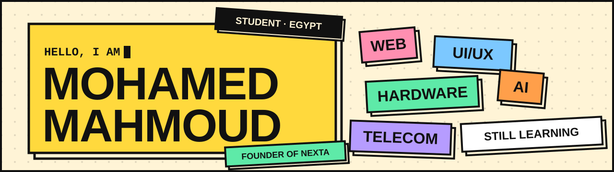
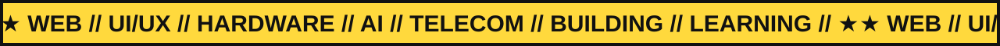

  

**An Egyptian student who loves building digital projects, taking hardware apart, and trying new technology to see how it works.**

 

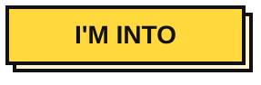

 

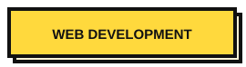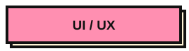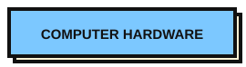
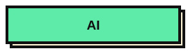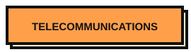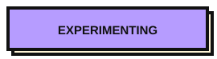

  

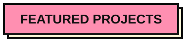

  

<a href="https://assrar-market.vercel.app/">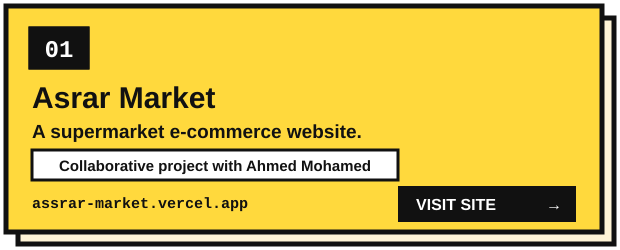</a>
<a href="https://masjid-el-sheikh-el-tayeb.vercel.app/#/home">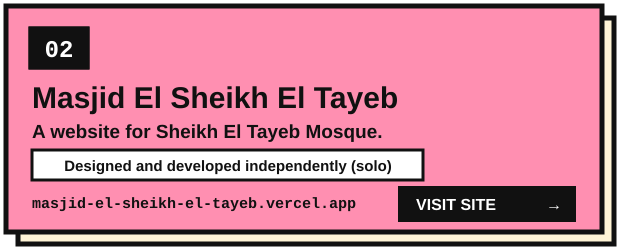</a>
<a href="https://mohamed-mma.github.io/Nexta/">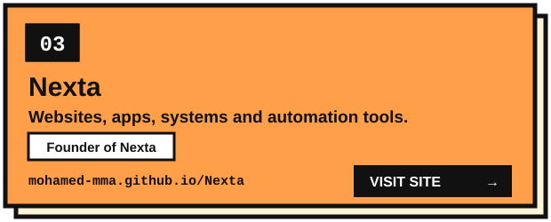</a>
<a href="https://mohamed-mma.github.io/Nexta-Link/">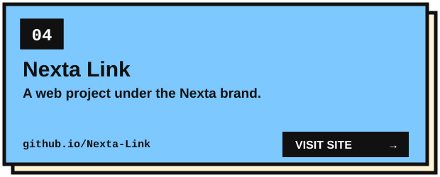</a>
<a href="https://mohamed-mma.github.io/DR_WalaaElMasry-certificates/">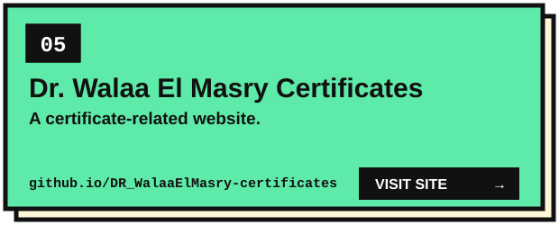</a>

Click any card to open the live site.

  

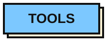

 

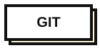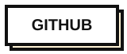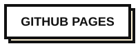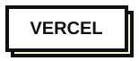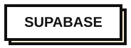

  

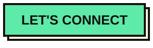

 

<a href="https://github.com/mohamed-Mma">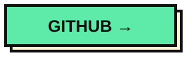</a>
<a href="mailto:momamoahas@gmail.com">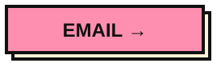</a>

  

Founder of Nexta · Still learning · always building

